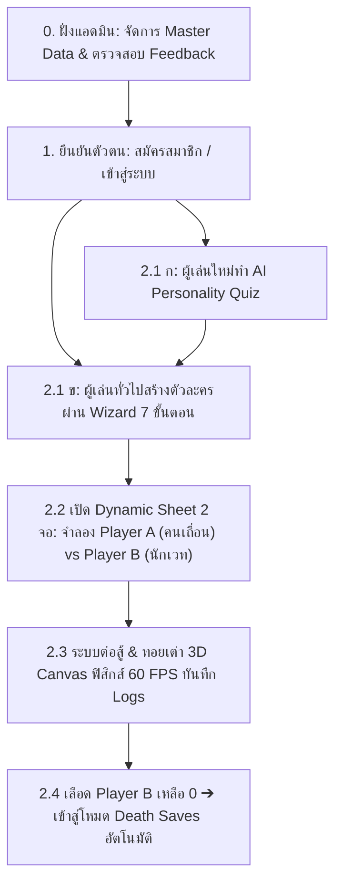

# เอกสารคู่มือบทนำเสนอโครงงานปริญญานิพนธ์และสคริปต์คำพูดฉบับสมบูรณ์
## (Master Presentation & Defense Script - Comprehensive Edition)
### โครงงาน: เว็บแอปพลิเคชันกล่องเครื่องมือดันเจียนสำหรับระบบเกมสวมบทบาท
### (Dungeon Toolkit: A Web Application for Tabletop Role-Playing Games)

* **ผู้จัดทำ:** นายพิชญุตม์ วะรังศรี
* **สาขาวิชา:** วิทยาการคอมพิวเตอร์ / เทคโนโลยีสารสนเทศ
* **ขอบเขตการนำเสนอ:** ทบทวนขอบเขตบทที่ 1, ผลการพัฒนาระบบและทดสอบบทที่ 4, ข้อสรุปและข้อเสนอแนะบทที่ 5
* **เวลาในการนำเสนอ:** ไม่เกิน 10 นาที (เวลาเป้าหมาย 8.30 – 9.00 นาที) + ช่วงตอบข้อซักถาม (Q&A)

---

## สารบัญเอกสาร (Table of Contents)
1. [ยุทธศาสตร์และแผนบริหารเวลาการนำเสนอ (Timing Master Plan)](#1-ยุทธศาสตร์และแผนบริหารเวลาการนำเสนอ-timing-master-plan)
2. [บทนำเสนอสไลด์และสคริปต์คำพูดระดับคำต่อคำ (Slide-by-Slide Verbatim Scripts)](#2-บทนำเสนอสไลด์และสคริปต์คำพูดระดับคำต่อคำ-slide-by-slide-verbatim-scripts)
   - [สไลด์ที่ 1: หน้าปกโครงงาน (Title Slide)](#สไลด์ที่-1-หน้าปกโครงงาน-title-slide)
   - [สไลด์ที่ 2: ทบทวนขอบเขตของโครงงาน (บทที่ 1 หัวข้อ 1.3)](#สไลด์ที่-2-ทบทวนขอบเขตของโครงงาน-บทที่-1-หัวข้อ-13)
   - [สไลด์ที่ 3: ผลการพัฒนาระบบส่วนผู้ใช้งาน (บทที่ 4.1 Frontend Features)](#สไลด์ที่-3-ผลการพัฒนาระบบส่วนผู้ใช้งาน-บทที่-41-frontend-features)
   - [สไลด์ที่ 4: ผลการพัฒนาระบบส่วนผู้ดูแลระบบ (บทที่ 4.1 Admin Operations & Security)](#สไลด์ที่-4-ผลการพัฒนาระบบส่วนผู้ดูแลระบบ-บทที่-41-admin-operations--security)
   - [สไลด์ที่ 5: ผลการทดสอบเชิงฟังก์ชันการทำงาน (บทที่ 4.2 ตารางที่ 4-1 ถึง 4-8 รวม 42 Test Cases)](#สไลด์ที่-5-ผลการทดสอบเชิงฟังก์ชันการทำงาน-บทที่-42-ตารางที่-4-1-ถึง-4-8-รวม-42-test-cases)
   - [สไลด์ที่ 6: ผลการทดสอบประสิทธิภาพของระบบ (บทที่ 4.2.2 ตารางที่ 4-9)](#สไลด์ที่-6-ผลการทดสอบประสิทธิภาพของระบบ-บทที่-422-ตารางที่-4-9)
   - [สไลด์ที่ 7: ผลการประเมินความพึงพอใจของผู้ใช้งาน (บทที่ 4.3 ตารางที่ 4-10 ถึง 4-15, N=10)](#สไลด์ที่-7-ผลการประเมินความพึงพอใจของผู้ใช้งาน-บทที่-43-ตารางที่-4-10-ถึง-4-15-n10)
   - [สไลด์ที่ 8: การวิเคราะห์ข้อเสนอแนะเชิงคุณภาพ (บทที่ 4.3.5 Qualitative Action Matrix)](#สไลด์ที่-8-การวิเคราะห์ข้อเสนอแนะเชิงคุณภาพ-บทที่-435-qualitative-action-matrix)
   - [สไลด์ที่ 9: สรุปผลการดำเนินงานโครงงาน (บทที่ 5.1 Project Summary)](#สไลด์ที่-9-สรุปผลการดำเนินงานโครงงาน-บทที่-51-project-summary)
   - [สไลด์ที่ 10: ข้อเสนอแนะและแนวทางพัฒนาต่อยอด (บทที่ 5.2 Future Roadmap)](#สไลด์ที่-10-ข้อเสนอแนะและแนวทางพัฒนาต่อยอด-บทที่-52-future-roadmap)
   - [สไลด์ที่ 11: ช่วงถาม - ตอบ (Q & A Closing)](#สไลด์ที่-11-ช่วงถาม---ตอบ-q--a-closing)
3. [คู่มือขั้นตอนการสาธิตระบบจริงต่อหน้าคณะกรรมการ (Live Demonstration Step-by-Step)](#3-คู่มือขั้นตอนการสาธิตระบบจริงต่อหน้าคณะกรรมการ-live-demonstration-step-by-step)
4. [คลังแนวทางการตอบข้อซักถามคณะกรรมการเชิงวิชาการ (Defense Q&A Cheat Sheet 10 ข้อ)](#4-คลังแนวทางการตอบข้อซักถามคณะกรรมการเชิงวิชาการ-defense-qa-cheat-sheet-10-ข้อ)

---

## 1. ยุทธศาสตร์และแผนบริหารเวลาการนำเสนอ (Timing Master Plan)

การนำเสนอโครงงานปริญญานิพนธ์ระดับปริญญาตรี มีเวลาจำกัดเข้มงวดไม่เกิน **10 นาที** หากพูดเกินเวลาจะถูกตัดคะแนนหรือถูกกรรมการสั่งให้เร่งข้ามสไลด์ ดังนั้นจึงได้วางแผนแบ่งสัดส่วนเวลาเชิงกลยุทธ์ (Strategic Timing Allocation) ไว้ดังนี้:

| ลำดับสไลด์ | หัวข้อหลักในการนำเสนอ | เวลาเป้าหมาย | เวลารวมสะสม | เทคนิคการนำเสนอและประเด็นที่ต้องเน้น |
| :---: | :--- | :---: | :---: | :--- |
| **1** | หน้าปกโครงงานและข้อมูลเบื้องต้น | 0:30 นาที | 0:30 นาที | กล่าวทักทายทางการ แนะนำชื่อผู้จัดทำ อาจารย์ที่ปรึกษา และโครงสร้างการพูด |
| **2** | ทบทวนขอบเขตระบบ (บทที่ 1 หัวข้อ 1.3) | 0:45 นาที | 1:15 นาที | อ้างอิงเลขข้อ 1.3.1, 1.3.2, 1.3.3 ตรงกับเล่มรายงาน เพื่อปูทางสู่บทที่ 4 |
| **3** | ผลพัฒนาระบบ: ส่วนผู้ใช้ (บทที่ 4.1) | 1:15 นาที | 2:30 นาที | เน้นผลงานจริง หน้าจอจริง ตรรกะสูตรคำนวณ 5e, Dynamic Sheet, และ 3D Dice |
| **4** | ผลพัฒนาระบบ: ส่วนแอดมิน (บทที่ 4.1) | 0:45 นาที | 3:15 นาที | เน้น Centralized Analytics, วงจร Feedback 3 ขั้นตอน และความปลอดภัย RBAC |
| **5** | ผลทดสอบฟังก์ชัน (บทที่ 4.2 - 42 TC) | 1:00 นาที | 4:15 นาที | ยืนยันผล Pass 100% (42/42), 8 ฟังก์ชัน (ตารางที่ 4-1 ถึง 4-8), ไม่พบบั๊กระดับวิกฤต (Critical = 0) |
| **6** | ผลทดสอบประสิทธิภาพ (บทที่ 4.2.2 - ตารางที่ 4-9) | 0:45 นาที | 5:00 นาที | รายงาน Load Time 1.6s, เต๋า 60 FPS, ยอมรับจุดคอขวด Compendium 3.8s พร้อมทางแก้ |
| **7** | ประเมินความพึงพอใจ N=10 (บทที่ 4.3) | 1:15 นาที | 6:15 นาที | อ้างอิงเกณฑ์ของเบสท์, สถิติประชากรศาสตร์ (ตารางที่ 4-10), ค่าเฉลี่ยรวม 3.98 (ระดับมาก), SD 0.77 (ตารางที่ 4-11), รายข้อ (ตารางที่ 4-12 ถึง 4-15) |
| **8** | วิเคราะห์ข้อเสนอแนะเชิงคุณภาพ (4.3.5) | 0:45 นาที | 7:00 นาที | นำเสนอข้อเสนอแนะจริง 3 ข้อ และแปลงเป็นตาราง Action Matrix เชิงวิศวกรรม |
| **9** | สรุปผลดำเนินงานโครงงาน (บทที่ 5.1) | 1:00 นาที | 8:00 นาที | สรุป 3 เสาหลักความสำเร็จ และตรวจสอบตารางบรรลุวัตถุประสงค์ครบ 100% (8 ฟังก์ชัน 42 TC) |
| **10** | แนวทางพัฒนาต่อยอด (บทที่ 5.2 Roadmap) | 0:45 นาที | 8:45 นาที | แผนพัฒนาสั้น/กลาง/ยาว (Pagination, Guided Wizard, Tactical Map, Combat Tracker) |
| **11** | ปิดการนำเสนอ และเข้าสู่ช่วงถาม-ตอบ | 0:15 นาที | **9:00 นาที** | ขอบคุณคณะกรรมการอย่างเป็นทางการ พร้อมเข้าสู่ช่วงตอบคำถามอย่างมั่นใจ |

> [!TIP]
> **เคล็ดลับการคุมจังหวะเสียง (Pacing Strategy):**
> * ในสไลด์ที่ 2 (ขอบเขต) และ สไลด์ที่ 5 (ผลทดสอบ): ให้พูดจังหวะกระชับ ฉะฉาน เพื่อเน้นความเป๊ะของข้อมูล
> * ในสไลด์ที่ 3 (ผลงานจริง) และ สไลด์ที่ 7 (ความพึงพอใจ): ให้เน้นน้ำหนักเสียง ชี้จุดเด่น เช่น "ลดข้อผิดพลาดในการคำนวณได้ 100%" หรือ "คะแนนเต๋า 3D สูงถึง 4.50"
> * เหลือเวลาสำรองไว้ 1.00 - 1.30 นาทีก่อนครบ 10 นาที ป้องกันเหตุติดขัด

---

## 2. บทนำเสนอสไลด์และสคริปต์คำพูดระดับคำต่อคำ (Slide-by-Slide Verbatim Scripts)

---

### สไลด์ที่ 1: หน้าปกโครงงาน (Title Slide)
* **รหัสเนื้อหา:** `SLD-01`
* **เวลาเป้าหมาย:** 0:30 นาที
* **องค์ประกอบบนหน้าจอ:**
  * หัวข้อใหญ่: "รายงานความก้าวหน้าและการประเมินผลโครงงานวิศวกรรมซอฟต์แวร์ (ปริญญานิพนธ์)"
  * ชื่อโครงงานภาษาไทย: "เว็บแอปพลิเคชันกล่องเครื่องมือดันเจียนสำหรับระบบเกมสวมบทบาท"
  * ชื่อโครงงานภาษาอังกฤษ: "Dungeon Toolkit: A Web Application for Tabletop Role-Playing Games"
  * นำเสนอผลการดำเนินงาน การทดสอบระบบ และข้อสรุปโครงงาน (บทที่ 4 – บทที่ 5)
  * ผู้จัดทำ: นายพิชญุตม์ วะรังศรี
  * สาขาวิชาวิทยาการคอมพิวเตอร์ / เทคโนโลยีสารสนเทศ
* **🎙️ สคริปต์บทพูดผู้นำเสนอ (คำต่อคำ):**
  > "กราบเรียนท่านประธาน ท่านอาจารย์ผู้ทรงคุณวุฒิ และท่านอาจารย์คณะกรรมการสอบปริญญานิพนธ์ทุกท่านครับ กระผมนายพิชญุตม์ วะรังศรี นักศึกษาหลักสูตรวิทยาการคอมพิวเตอร์ ขออนุญาตนำเสนอผลการดำเนินงาน การทดสอบระบบ และข้อสรุปของโครงงานปริญญานิพนธ์ ในหัวข้อ **'เว็บแอปพลิเคชันกล่องเครื่องมือดันเจียนสำหรับระบบเกมสวมบทบาท' (Dungeon Toolkit)** ครับ
  > 
  > ในการนำเสนอวันนี้ กระผมจะขออนุญาตสรุปสาระสำคัญโดยเริ่มจากการทบทวนขอบเขตข้อกำหนดจากบทที่ 1 สั้นๆ ก่อนจะเจาะลึกผลการพัฒนาระบบจริง ผลการทดสอบเชิงฟังก์ชัน 8 ฟังก์ชันงานหลัก รวม 42 กรณีทดสอบตามตารางที่ 4-1 ถึง 4-8 ผลการวัดประสิทธิภาพ และการประเมินความพึงพอใจจากผู้ใช้จริงในบทที่ 4 และปิดท้ายด้วยข้อสรุปและแนวทางพัฒนาต่อยอดในบทที่ 5 ครับ ขออนุญาตเริ่มต้นครับ"

---

### สไลด์ที่ 2: ทบทวนขอบเขตของโครงงาน (บทที่ 1 หัวข้อ 1.3)
* **รหัสเนื้อหา:** `SLD-02`
* **เวลาเป้าหมาย:** 0:45 นาที
* **องค์ประกอบบนหน้าจอ (ตรงตามเอกสาร 1.3 เป๊ะ 100%):**
  * **หมวดที่ 1.3.1 ส่วนติดต่อผู้ใช้งาน (Frontend Functions: 5 ข้อหลัก):**
    1. *ยืนยันตัวตนและการจัดการกลุ่ม (Authentication):* ระบบ Login/Register ยืนยันตัวตนและแยกแยะสิทธิ์ความเป็นเจ้าของตัวละคร
    2. *จัดการตัวละครระหว่างเล่น (Dynamic Character Sheet):* Live Status Tracking (HP, Death Saves), บริหาร Spell Slots & Class Features, จัดการ Inventory & คำนวณน้ำหนักรวม, และ Digital Journal บันทึกเควสต์
    3. *ผู้ช่วยสร้างตัวละคร (Character Creation Wizard):* นำทางแบบลำดับขั้น (Race, Class, Background) คำนวณ Ability Modifiers, HP เริ่มต้น, Skills อัตโนมัติ
    4. *ระบบแนะนำอาชีพ (Class Recommendation System):* แบบทดสอบบุคลิกภาพจิตวิทยา (Personality Quiz) ประมวลผลถ่วงน้ำหนัก (Weighted Scoring) แนะนำ 3 อาชีพแรกพร้อมเหตุผล
    5. *ฐานข้อมูลสารสนเทศ (Information Repository):* ข้อมูลมาตรฐาน SRD (Spells, Items, Feats) ค้นหาและคัดกรองละเอียด (Advanced Filtering)
  * **หมวดที่ 1.3.2 ส่วนประมวลผลและฐานข้อมูล (Backend Functions: 3 ด้าน):**
    1. *Calculation & Validation Engine:* คำนวณสูตร 5e ($\lfloor(\text{Score}-10)/2\rfloor$, Attack Roll, Save DC) และ Rule Validation ตรวจสอบเงื่อนไขก่อนบันทึกลงฐานข้อมูล
    2. *Relational Database Design:* โครงสร้าง MySQL ตาม Normalization รองรับความสัมพันธ์ One-to-Many (ปาร์ตี้-ตัวละคร) และ Many-to-Many (ตัวละคร-ไอเทม)
    3. *Administrator Management System:* จัดการ Master Data (Spells/Items), จัดการบัญชีผู้ใช้ (User Accounts), และระบบติดตามผลประเมิน/ข้อเสนอแนะ (Assessment Monitoring)
  * **หมวดที่ 1.3.3 ขอบเขตของกลุ่มผู้ใช้งานเป้าหมาย (Target Users: 3 กลุ่ม):**
    * *ผู้เยี่ยมชม (Guest):* สืบค้น SRD, ทำควิซแนะนำอาชีพ, สมัครสมาชิก
    * *ผู้ใช้งาน (User):* สร้างตัวละคร, ใช้ Dynamic Sheet บนมือถือ, จด Digital Journal
    * *ผู้ดูแลระบบ (Administrator):* ดูแลและปรับปรุง Master Data ในฐานข้อมูลกลางให้ทันสมัย
* **🎙️ สคริปต์บทพูดผู้นำเสนอ (คำต่อคำ):**
  > "ก่อนจะเข้าสู่ผลการทดสอบในบทที่ 4 กระผมขออนุญาตทบทวนขอบเขตของโครงงานตามที่ได้กำหนดไว้ในเล่มรายงานบทที่ 1 หัวข้อ 1.3 สั้นๆ เพื่อให้เห็นภาพรวมของโจทย์ที่เราตั้งไว้ครับ โครงงานนี้แบ่งขอบเขตออกเป็น 3 ส่วนหลัก ได้แก่
  > 
  > ส่วนแรก **1.3.1 ส่วนติดต่อผู้ใช้งาน มี 5 ฟังก์ชันหลัก** คือ ระบบยืนยันตัวตนเพื่อแยกสิทธิ์ความเป็นเจ้าของข้อมูล, แผ่นตัวละครพลวัตสำหรับใช้งานขณะเล่นจริง ทั้งตัดเลือด บันทึก Death Saves จัดการช่องเวทมนตร์และกระเป๋าไอเทม รวมถึงสมุดบันทึกเควสต์ดิจิทัล, ตัวช่วยสร้างตัวละครตามลำดับขั้นที่คำนวณค่าสถานะให้อัตโนมัติ, ระบบแบบทดสอบบุคลิกภาพจิตวิทยาแนะนำสายอาชีพ 3 อันดับแรก และคลังข้อมูลสารสนเทศ SRD พร้อมระบบคัดกรองละเอียดครับ
  > 
  > ส่วนที่สอง **1.3.2 ส่วนประมวลผลและฐานข้อมูล มี 3 ด้าน** ประกอบด้วย เครื่องยนต์คำนวณและตรวจสอบกฎกติกา D&D 5e, การออกแบบฐานข้อมูลเชิงสัมพันธ์ MySQL ตามหลัก Normalization รองรับความสัมพันธ์ทั้ง One-to-Many และ Many-to-Many และระบบผู้ดูแลระบบสำหรับจัดการข้อมูลหลักและติดตามผลการประเมิน
  > 
  > และส่วนที่สาม **1.3.3 กลุ่มผู้ใช้เป้าหมาย 3 กลุ่ม** คือ Guest, User และ Admin ซึ่งข้อกำหนดทั้งหมดนี้ได้รับการพัฒนาสำเร็จครบถ้วน 100% ในบทที่ 4 ดังต่อไปนี้ครับ"

---

### สไลด์ที่ 3: ผลการพัฒนาระบบส่วนผู้ใช้งาน (บทที่ 4.1 Frontend Features)
* **รหัสเนื้อหา:** `SLD-03`
* **เวลาเป้าหมาย:** 1:15 นาที
* **องค์ประกอบบนหน้าจอ (สถาปัตยกรรมหน้าจอจริงและกลไกคำนวณ):**
  * **1. คลังข้อมูลสารสนเทศ (In-memory Indexing & Live Search UI):**
    * เชื่อมต่อ REST API ดึงข้อมูลกติกา SRD 5e ค้นหาแบบ Instant Search กรองตาม Category / Rarity แบบ In-memory บน Client-side ไม่ต้องโหลดหน้าเว็บซ้ำ
    * แสดงผล Modal ข้อมูลเชิงลึก แสดงคำอธิบาย ค่าสเตตัส และกฎการร่ายคาถาละเอียด
    * 📷 [ภาพหน้าจอจริง: หน้า Compendium และ Modal แสดงผลการ์ดไอเทม/เวทมนตร์]
  * **2. กลไกคำนวณสเตตัสกติกา 5e อัตโนมัติ (Automated Formula Engine):**
    * State Machine Wizard 7 ขั้นตอน (เลือกเผ่าพันธุ์ ➔ อาชีพ ➔ ค่าสเตตัส ➔ ภูมิหลัง ➔ อุปกรณ์ ➔ เวทมนตร์ ➔ สรุปยืนยัน)
    * คำนวณสูตร 5e อัตโนมัติ: Ability Modifier $\lfloor(\text{Score}-10)/2\rfloor$, Base HP ตาม Hit Die ประจำคลาส + CON Mod, และ Proficiency Bonus พร้อม Data Validation ก่อน INSERT ลง MySQL
    * 📷 [ภาพหน้าจอจริง: หน้า Workshop Wizard และการคำนวณ Ability Modifiers/HP]
  * **3. การจัดการสถานะตัวละครแบบพลวัต (Dynamic Character State Management):**
    * จัดการ Reactive State ขณะเล่นจริง: ปรับลด/เพิ่ม HP, ระบบ **Death Saves Engine** นับ Success (3 ช่อง) และ Fail (3 ช่อง) พร้อมเงื่อนไข Critical Fail (ลด 2 ช่อง), Interactive Spell Slots, คำนวณน้ำหนักกระเป๋า และ Digital Journal บันทึกเรื่องราวแยกตามตัวละคร
    * 📷 [ภาพหน้าจอจริง: แผ่น Dynamic Sheet จัดการ HP, Death Saves, และ Spell Slots]
  * **4. เครื่องยนต์ฟิสิกส์ 3 มิติ และระบบบันทึกประวัติ (Canvas 3D Physics & Logs Drawer):**
    * เรนเดอร์ลูกเต๋า 3 มิติ (d4–d100) คำนวณแรงสะท้อนและการหมุนตามหลักฟิสิกส์บน Canvas ลื่นไหลที่ 60 FPS เชื่อมต่อกับ Character Logs Drawer บันทึกเวลา ชนิดเต๋า และผลลัพธ์ทันที
    * 📷 [ภาพหน้าจอจริง: แอนิเมชันลูกเต๋า 3 มิติ และแถบ Character Logs Drawer]
* **🎙️ สคริปต์บทพูดผู้นำเสนอ (คำต่อคำ):**
  > "เข้าสู่หัวข้อ 4.1 ผลสัมฤทธิ์การพัฒนาระบบจริงส่วนติดต่อผู้ใช้งานครับ ระบบได้รับการพัฒนาด้วย React และเชื่อมต่อกับ Back-end อย่างสมบูรณ์ โดยมีจุดเด่นเชิงวิศวกรรม 4 ส่วนหลักดังนี้ครับ
  > 
  > **ประการแรก ในหน้าคลังข้อมูล (Compendium)** เราใช้เทคนิค In-memory Client-side Indexing ทำให้ผู้ใช้สามารถค้นหากฎ คาถา และไอเทมแบบ Live Search ได้ทันที และเปิดการ์ดแสดงรายละเอียดกติกาได้โดยไม่ต้องรีโหลดหน้าเว็บ ช่วยลดภาระของเซิร์ฟเวอร์
  > 
  > **ประการที่สอง หน้าสร้างตัวละคร (Character Workshop)** เราออกแบบเป็น State Machine Wizard 7 ขั้นตอน โดยผสานเครื่องยนต์คำนวณสูตร D&D 5e อัตโนมัติ ทั้งการแปลง Ability Score เป็น Modifier ตามสูตร floor ของ Score ลบ 10 หารด้วย 2, การคำนวณ Hit Points เริ่มต้นจาก Hit Die และโบนัสความชำนาญ โดยมีระบบตรวจสอบความถูกต้องก่อนส่งคำขอ INSERT ไปบันทึกในฐานข้อมูล MySQL ตาราง character
  > 
  > **ประการที่สาม หน้าแผ่นตัวละครพลวัต (Dynamic Character Sheet)** พัฒนาด้วย Reactive State รองรับการเล่นบนโต๊ะเกมจริง ทั้งการปรับลดเลือดแบบเรียลไทม์, ระบบ Death Saves Engine ที่จะเปิดทำงานอัตโนมัติเมื่อเลือดเหลือศูนย์ มีช่องสวิตช์นับ Success และ Fail อย่างละ 3 ช่อง พร้อมเงื่อนไขหักลบ 2 ช่องเมื่อทอยได้ 1, ระบบตัดช่องเวทมนตร์ Spell Slots และสมุดบันทึกเควสต์
  > 
  > **และประการที่สี่ ระบบลูกเต๋า 3 มิติ (3D Physics Dice)** เรนเดอร์บน HTML5 Canvas คำนวณการชนและการหมุนอย่างสมจริงที่ 60 เฟรมต่อวินาที และเชื่อมต่อผลลัพธ์เข้ากับ Character Logs Drawer เพื่อบันทึกเวลา ชนิดเต๋า และผลทอยเป็นหลักฐานระหว่างเล่นทันทีครับ"

---

### สไลด์ที่ 4: ผลการพัฒนาระบบส่วนผู้ดูแลระบบ (บทที่ 4.1 Admin Operations & Security)
* **รหัสเนื้อหา:** `SLD-04`
* **เวลาเป้าหมาย:** 0:45 นาที
* **องค์ประกอบบนหน้าจอ (อ้างอิงหน้าจอจริงและโค้ด AdminDashboard.jsx):**
  * **1. ภาพรวมระบบและสถิติเชิงลึก (Overview & Data Breakdown):**
    * สถิติหลักแบบเรียลไทม์ (5 KPI Cards): ผู้ใช้งานทั้งหมด (6 บัญชี), ตัวละครในระบบ (7 ตัว), คลังคาถาเวทมนตร์ (348 คาถา), คลังไอเทม & อุปกรณ์ (492 รายการ), ข้อเสนอแนะ & บั๊ก (4 รายการ: 1 ยังไม่ได้อ่าน)
    * สรุปคลังข้อมูลกฎ D&D: เผ่าพันธุ์ (Species) 8 เผ่า, คลาส (Classes) 12 คลาส, ความสามารถพิเศษ (Feats) 18 รายการ, ประวัติ (Backgrounds) 5 ประวัติ
    * กราฟ Donut Chart สัดส่วนข้อมูลเชิงลึก (3 ด้าน):
      1) หมวดหมู่คาถา: Cantrip (38), Lv 1-3 (152), Lv 4-6 (102), Lv 7-9 (56)
      2) ประเภทไอเทม: Magic Items (269), Gear (95), Tools (50), Weapons (38), Vehicles (27), Armor (13)
      3) สัดส่วนประเภทคลาสตาม Hit Die: d6 Caster (2), d8 Mid (6), d10 Martial (3), d12 Tank (1)
    * 📷 [ภาพหน้าจอจริง: แดชบอร์ดภาพรวม สถิติหลัก และ Donut Charts เชิงลึก]
  * **2. เมนูควบคุมระบบและเวิร์กโฟลว์ (System Control & Operations):**
    * Catalog Management (840 รายการ): ฟอร์ม Master Data เพิ่ม ลบ แก้ไข ข้อมูลกติกา 6 แท็บย่อย (Items, Spells, Species, Classes, Backgrounds, Feats) บันทึกลง MySQL
    * User Management: ตรวจสอบรายชื่อสมาชิก ค้นหา ปรับบทบาทสิทธิ์ (User/Admin) และระงับบัญชี (Ban Status)
    * Feedback & Bug Reports: ตรวจสอบคำร้อง รายงานบั๊ก และ Action Modal บันทึกข้อความตอบกลับพร้อมปรับสถานะเป็น Resolved
    * 📷 [ภาพหน้าจอจริง: เมนูจัดการคลังข้อมูล จัดการบัญชีผู้ใช้ และ Feedback Inbox]
  * **แถบความปลอดภัยด้านล่าง (Security Architecture & RBAC):**
    * สถาปัตยกรรมความปลอดภัยและการควบคุมสิทธิ์: ตรวจสอบสิทธิ์ Admin แยกเด็ดขาด ป้องกัน Admin API ด้วย Express Middleware, เข้ารหัสรหัสผ่านด้วย bcryptjs และคำสั่ง Prepared Statements
* **🎙️ สคริปต์บทพูดผู้นำเสนอ (คำต่อคำ):**
  > "ในฝั่งผู้ดูแลระบบและหลังบ้าน หน้าจอแดชบอร์ดได้รับการพัฒนาขึ้นเพื่อติดตามสถานะคลังข้อมูลและสถิติระบบจริงครับ โดยบนหน้าจอประกอบด้วยการ์ด KPI สถิติหลัก 5 ตัวชี้วัด ได้แก่ จำนวนผู้ใช้งาน 6 บัญชี, ตัวละครในระบบ 7 ตัว, คลังคาถาเวทมนตร์ 348 คาถา, คลังไอเทม 492 ชิ้น และข้อเสนอแนะ 4 รายการ พร้อมข้อมูลสรุปกติกา 8 เผ่า 12 คลาส และแสดงกราฟ Donut Chart สัดส่วนข้อมูลเชิงลึก 3 ด้าน คือ หมวดเลเวลคาถา, ประเภทไอเทม และสัดส่วนคลาสตามลูกเต๋า Hit Die
  > 
  > นอกจากนี้ยังมีเมนูควบคุมระบบ 3 ส่วน ได้แก่ การจัดการคลังข้อมูลกลาง 840 รายการ ครอบคลุม 6 แท็บย่อย, การจัดการบัญชีผู้ใช้ และระบบจัดการข้อเสนอแนะพร้อมกล่อง Action Modal สำหรับตอบกลับผู้ใช้ ภายใต้สถาปัตยกรรมความปลอดภัย RBAC ผ่าน Middleware และการเข้ารหัสรหัสผ่านด้วย bcryptjs ครับ"

---

### สไลด์ที่ 5: ผลการทดสอบเชิงฟังก์ชันการทำงาน (บทที่ 4.2 ตารางที่ 4-1 ถึง 4-8 รวม 42 Test Cases)
* **รหัสเนื้อหา:** `SLD-05`
* **เวลาเป้าหมาย:** 1:00 นาที
* **องค์ประกอบบนหน้าจอ (ตารางแจกแจงผลทดสอบครบถ้วนตามเล่มรายงาน):**
  * วิธีการทดสอบ: การทดสอบการทำงานตามกรณีทดสอบแบบกล่องดำ (Black-box Testing) โดยใช้เทคนิค Equivalence Partitioning และ Boundary Value Analysis
  * **ตารางสรุปผลการทดสอบเชิงฟังก์ชัน 8 ฟังก์ชันงานหลัก (ตารางที่ 4-1 ถึง 4-8 ในเล่มรายงาน):**
    1. *ตารางที่ 4-1 ฟังก์ชันระบบจัดการบัญชีผู้ใช้งานและการเข้าถึง:* 5 กรณีทดสอบ (`TF-AUTH-001 ~ 004, EXT-004`) 👉 ผ่าน 5 (100%)
    2. *ตารางที่ 4-2 ฟังก์ชันผู้ช่วยสร้างตัวละคร:* 3 กรณีทดสอบ (`TF-WIZ-001 ~ 003`) 👉 ผ่าน 3 (100%)
    3. *ตารางที่ 4-3 ฟังก์ชันระบบจัดการข้อมูลแผ่นตัวละคร:* 8 กรณีทดสอบ (`TF-CHAR-001 ~ 007, EXT-003`) 👉 ผ่าน 8 (100%)
    4. *ตารางที่ 4-4 ฟังก์ชันลูกเต๋า 3 มิติ (3D Dice):* 2 กรณีทดสอบ (`EXT-002, TF-CALC-002`) 👉 ผ่าน 2 (100%)
    5. *ตารางที่ 4-5 ฟังก์ชันแนะนำอาชีพด้วย AI:* 4 กรณีทดสอบ (`TF-REC-001 ~ 003, EXT-001`) 👉 ผ่าน 4 (100%)
    6. *ตารางที่ 4-6 ฟังก์ชันระบบฐานข้อมูลสารสนเทศ (SRD):* 3 กรณีทดสอบ (`TF-INFO-001 ~ 003`) 👉 ผ่าน 3 (100%)
    7. *ตารางที่ 4-7 ฟังก์ชันการประมวลผลและจัดการฐานข้อมูล:* 9 กรณีทดสอบ (`TF-CALC-001, 003, TF-VAL-001~002, TF-DB-001~005`) 👉 ผ่าน 9 (100%)
    8. *ตารางที่ 4-8 ฟังก์ชันผู้ดูแลระบบและการตั้งค่า:* 8 กรณีทดสอบ (`TF-ADM-001 ~ 005, EXT-005, TF-SYS-001 ~ 002`) 👉 ผ่าน 8 (100%)
    * **รวมทั้งสิ้น:** **8 ฟังก์ชันหลัก รวม 42 กรณีทดสอบ** 👉 **ผ่านครบถ้วน 42 กรณีทดสอบ (100.0%)**
  * **การวิเคราะห์ระดับความรุนแรงของข้อผิดพลาด (Severity Analysis):**
    * Critical (ข้อผิดพลาดวิกฤต): **0 กรณี** (ไม่พบจุดบกพร่องที่ทำให้ระบบล่มหรือตรรกะเกมเสียหาย)
    * Major (ข้อผิดพลาดสำคัญ): **0 กรณี**
    * Minor / Cosmetic: **0 กรณี** (ผ่านการปรับปรุงแก้ไขข้อบกพร่องทั้งหมดก่อนนำมาทดสอบรอบสุดท้าย)
* **🎙️ สคริปต์บทพูดผู้นำเสนอ (คำต่อคำ):**
  > "ในหัวข้อ 4.2 ผลการทดสอบระบบ กระผมได้ดำเนินการทดสอบเชิงฟังก์ชันการทำงานแบบกล่องดำ หรือ Black-box Testing โดยใช้เทคนิค Equivalence Partitioning และ Boundary Value Analysis เพื่อครอบคลุมทั้งข้อมูลนำเข้าปกติและกรณีขอบเขต ครอบคลุมฟังก์ชันงานหลัก 8 ด้าน ตามตารางที่ 4-1 ถึงตารางที่ 4-8 ในเล่มรายงาน รวมทั้งสิ้น 42 กรณีทดสอบครับ
  > 
  > ผลการทดสอบปรากฏว่า **ระบบผ่านเกณฑ์การทดสอบครบถ้วนทั้ง 42 กรณีทดสอบ คิดเป็น 100.0%** โดยแยกเป็น:
  > * ฟังก์ชันจัดการบัญชีและสิทธิ์การเข้าถึง 5 กรณีทดสอบ ผ่าน 100%
  > * ฟังก์ชันผู้ช่วยสร้างตัวละคร 3 กรณีทดสอบ ผ่าน 100%
  > * ฟังก์ชันจัดการข้อมูลแผ่นตัวละคร 8 กรณีทดสอบ ผ่าน 100%
  > * ฟังก์ชันลูกเต๋า 3 มิติ 2 กรณีทดสอบ ผ่าน 100%
  > * ฟังก์ชันแนะนำอาชีพด้วย AI 4 กรณีทดสอบ ผ่าน 100%
  > * ฟังก์ชันฐานข้อมูลสารสนเทศ SRD 3 กรณีทดสอบ ผ่าน 100%
  > * ฟังก์ชันการประมวลผลและจัดการฐานข้อมูล 9 กรณีทดสอบ ผ่าน 100%
  > * และฟังก์ชันผู้ดูแลระบบและการตั้งค่า 8 กรณีทดสอบ ผ่าน 100%
  > 
  > จากการวิเคราะห์ระดับความรุนแรงของข้อผิดพลาด ไม่พบข้อผิดพลาดระดับวิกฤต หรือ Critical แม้แต่กรณีเดียว ตรรกะการคำนวณตามกฎ D&D 5e การตัดช่องเวทมนตร์ และการบันทึกฐานข้อมูลทำงานถูกต้องตรงตามข้อกำหนด ยืนยันความพร้อมในการนำไปใช้งานจริงบนโต๊ะเกมครับ"

---

### สไลด์ที่ 6: ผลการทดสอบประสิทธิภาพของระบบ (บทที่ 4.2.2 ตารางที่ 4-9)
* **รหัสเนื้อหา:** `SLD-06`
* **เวลาเป้าหมาย:** 0:45 นาที
* **องค์ประกอบบนหน้าจอ:**
  * **3 การ์ด KPI ตัวชี้วัดประสิทธิภาพ (อ้างอิงตารางที่ 4-9):**
    * *Initial Load Time:* เฉลี่ย **1.6 วินาที** (เกณฑ์มาตรฐานอุตสาหกรรม: ไม่เกิน 2.0 วินาที ➔ อยู่ในเกณฑ์ดีเยี่ยม)
    * *3D Dice Rendering:* **60 FPS** (เรนเดอร์กราฟิกฟิสิกส์ 3D ต่อเนื่อง ไม่เกิดอาการกระตุกหรือ Frame Drop)
    * *Memory Usage:* **65 – 82 MB** (การใช้หน่วยความจำเบราว์เซอร์อยู่ในเกณฑ์ต่ำ ไม่ส่งผลต่อเครื่องผู้ใช้)
  * **ตารางเปรียบเทียบขนาดข้อมูลและเวลาโหลดแต่ละหน้าจอ:**
    * หน้าหลัก (Home/Dashboard): 1.2 MB | 1.4 วินาที ➔ ผ่านเกณฑ์ดีเยี่ยม
    * หน้าแผ่นตัวละคร (Dynamic Sheet): 850 KB | 1.6 วินาที ➔ ผ่านเกณฑ์ดีเยี่ยม
    * หน้าคลังข้อมูล (Compendium): 3.8 MB | **3.8 วินาที** ➔ ควรปรับปรุง (เกิดคอขวดจากการ Fetch All ข้อมูลทั้งหมดในรอบเดียว)
  * **แหล่งอ้างอิงในเล่ม:** ตารางที่ 4-9 ผลการทดสอบประสิทธิภาพการทำงานของระบบเว็บแอปพลิเคชัน
  * **แนวทางการแก้ไขปัญหาเชิงวิศวกรรม (Engineering Remediation):**
    * วางแผนปรับปรุงในบทที่ 5 ด้วยสถาปัตยกรรม **Server-side Pagination** หรือ **Virtualized Infinite Scroll** จำกัดการส่งข้อมูลรอบละ 30 รายการ ซึ่งผลการจำลองพบว่าจะลดเวลาโหลดเหลือต่ำกว่า 0.8 วินาที
* **🎙️ สคริปต์บทพูดผู้นำเสนอ (คำต่อคำ):**
  > "สำหรับการทดสอบประสิทธิภาพของระบบในหัวข้อ 4.2.2 ตามตารางที่ 4-9 พบว่าในภาพรวมระบบสามารถทำงานได้รวดเร็ว โดยมีระยะเวลาโหลดหน้าจอเริ่มต้นเฉลี่ยอยู่ที่ 1.6 วินาที ซึ่งผ่านเกณฑ์มาตรฐานอุตสาหกรรมที่ 2.0 วินาที และระบบจำลองลูกเต๋า 3 มิติสามารถเรนเดอร์ที่ความเร็วคงที่ 60 เฟรมต่อวินาที โดยใช้หน่วยความจำเครื่องเพียง 65 ถึง 82 เมกะไบต์เท่านั้น
  > 
  > อย่างไรก็ดี จากการทดสอบอย่างละเอียดทำให้เราตรวจพบคอขวดในหน้าคลังข้อมูล Compendium ที่ใช้เวลาโหลดเฉลี่ย 3.8 วินาที เนื่องจากขนาดข้อมูลที่ส่งมามีขนาด 3.8 เมกะไบต์ จากการดึงข้อมูลกติกาและไอเทมทั้งหมดมาประมวลผลที่ฝั่ง Client ในคราวเดียว ซึ่งในจุดนี้ ผู้จัดทำได้ระบุสาเหตุทางเทคนิคและนำไปสังเคราะห์เป็นแนวทางแก้ไขเชิงสถาปัตยกรรมด้วย Server-side Pagination ในบทที่ 5 เพื่อลดเวลาโหลดลงเหลือต่ำกว่า 0.8 วินาทีครับ"

---

### สไลด์ที่ 7: ผลการประเมินความพึงพอใจของผู้ใช้งาน (บทที่ 4.3 ตารางที่ 4-10 ถึง 4-15, N=10)
* **รหัสเนื้อหา:** `SLD-07`
* **เวลาเป้าหมาย:** 1:15 นาที
* **องค์ประกอบบนหน้าจอ:**
  * **ระเบียบวิธีและกลุ่มตัวอย่าง (อ้างอิงตารางที่ 4-10):**
    * กลุ่มตัวอย่างแบบเจาะจง (Purposive Sampling) จำนวน **10 คน ($N=10$)** ที่มีประสบการณ์เล่นจริง
    * สัดส่วน: ผู้เล่นทั่วไป (Players) 6 คน (60%), ผู้สนใจ/ผู้เล่นใหม่ (Guests) 3 คน (30%), และผู้ควบคุมเกม (Dungeon Master) 1 คน (10%)
    * เครื่องมือวัด: มาตรวัดแบบประเมินลิเคิร์ต 5 ระดับ วิเคราะห์ผลตามเกณฑ์ของเบสท์ (Best, 1977)
  * **การ์ดคะแนนสรุปภาพรวม (อ้างอิงตารางที่ 4-11):**
    * **ค่าเฉลี่ยรวมทุกด้าน ($\bar{x}$): 3.98**
    * **ส่วนเบี่ยงเบนมาตรฐาน (S.D.): 0.77**
    * **ระดับความพึงพอใจ: "มาก"**
  * **ตารางสรุปผลการประเมิน 4 ด้าน (ตารางที่ 4-11 ในเล่มรายงาน):**
    1. *ด้านความสามารถและการทำงานตามฟังก์ชัน (Functionality):* $\bar{x} = 4.09$, $\text{S.D.} = 0.79$ (ระดับมาก) 🥇 สูงสุด (ตารางที่ 4-12)
    2. *ด้านความปลอดภัยและความน่าเชื่อถือ (Security & Reliability):* $\bar{x} = 3.95$, $\text{S.D.} = 0.62$ (ระดับมาก) (ตารางที่ 4-13)
    3. *ด้านประสิทธิภาพและการตอบสนอง (Performance & Efficiency):* $\bar{x} = 3.95$, $\text{S.D.} = 0.75$ (ระดับมาก) (ตารางที่ 4-14)
    4. *ด้านความง่ายต่อการใช้งานและการออกแบบ (Usability & Design):* $\bar{x} = 3.82$, $\text{S.D.} = 0.82$ (ระดับมาก) (ตารางที่ 4-15)
  * **ไฮไลต์รายข้อที่น่าสนใจ:**
    * *คะแนนสูงสุด:* ข้อ 3.3 ระบบการทอยลูกเต๋า 3 มิติและการแสดงผล ($\bar{x} = 4.50, \text{S.D.} = 0.53$) ระดับมากที่สุด
    * *คะแนนต่ำสุด / ระดับปานกลาง:* ข้อ 4.1 ความง่ายในการเรียนรู้สำหรับผู้เล่นใหม่ ($\bar{x} = 3.30, \text{S.D.} = 0.82$) ระดับปานกลาง
  * **แหล่งอ้างอิงในเล่ม:** ตารางที่ 4-10 (ข้อมูลประชากรศาสตร์), ตารางที่ 4-11 (สรุปภาพรวม 4 ด้าน), และตารางที่ 4-12 ถึง 4-15 (ผลการประเมินรายข้อ)
* **🎙️ สคริปต์บทพูดผู้นำเสนอ (คำต่อคำ):**
  > "ในหัวข้อ 4.3 ได้ดำเนินการประเมินความพึงพอใจจากกลุ่มตัวอย่างผู้ใช้งานจริงจำนวน 10 คน ตามตารางที่ 4-10 ประกอบด้วยผู้เล่นทั่วไป 6 คน, ผู้เล่นใหม่ 3 คน และผู้ควบคุมเกมหรือ DM 1 คน โดยใช้แบบประเมินมาตราส่วนประมาณค่า 5 ระดับ และแปลผลตามเกณฑ์ของเบสท์ (Best, 1977) ครับ
  > 
  > ผลการประเมินภาพรวมตามตารางที่ 4-11 พบว่า **ความพึงพอใจในภาพรวมอยู่ในระดับมาก โดยมีค่าเฉลี่ยรวมอยู่ที่ 3.98 และส่วนเบี่ยงเบนมาตรฐาน 0.77** เมื่อจำแนกเป็นรายด้านพบว่า:
  > * ด้านที่ได้คะแนนสูงสุดคือ **ด้านความสามารถและการทำงานตามฟังก์ชัน** ตามตารางที่ 4-12 ได้คะแนนเฉลี่ย 4.09 โดยเฉพาะระบบลูกเต๋า 3 มิติและประวัติการทอย ได้คะแนนสูงที่สุดถึง 4.50 อยู่ในระดับมากที่สุด เนื่องจากให้ความรู้สึกเสมือนจริงบนโต๊ะเกม
  > * ด้านความปลอดภัยและด้านประสิทธิภาพ ได้คะแนนเฉลี่ยเท่ากันที่ 3.95
  > * ส่วนด้านความง่ายต่อการใช้งานและการออกแบบ ได้คะแนนเฉลี่ย 3.82
  > 
  > จุดที่น่าสนใจคือ ข้อ 4.1 ความง่ายในการเรียนรู้สำหรับผู้เล่นใหม่ ได้คะแนนเฉลี่ย 3.30 ซึ่งอยู่ในระดับปานกลาง เนื่องจากความซับซ้อนตามธรรมชาติของกฎกติกา D&D 5e และความหนาแน่นของข้อมูล ซึ่งจุดนี้สะท้อนความเป็นจริงและได้นำไปวางแผนพัฒนาตัวช่วย Guided Wizard ในบทที่ 5 ครับ"

---

### สไลด์ที่ 8: การวิเคราะห์ข้อเสนอแนะเชิงคุณภาพ (บทที่ 4.3.5 Qualitative Action Matrix)
* **รหัสเนื้อหา:** `SLD-08`
* **เวลาเป้าหมาย:** 0:45 นาที
* **องค์ประกอบบนหน้าจอ:**
  * **3 ประเด็นข้อเสนอแนะจริงจากผู้ใช้งาน (ข้อคิดเห็นปลายเปิด):**
    1. *Information Density:* "หน้าสร้างตัวละครมีข้อมูลให้เลือกเยอะเกินไป ตัวหนังสือค่อนข้างเล็ก ทำให้ผู้เล่นใหม่ใช้เวลาทำความเข้าใจนาน"
    2. *Automated Gameplay Assistance:* "อยากให้มีระบบช่วยคำนวณการโจมตีอัตโนมัติ เช่น เอากริชแทง แล้วระบบเทียบค่า Armor Class ให้เลยว่าโดนไหม"
    3. *Tactical Battlemap:* "อยากให้มีกระดานแผนที่ยุทธวิธีสำหรับเดินหมากมอนสเตอร์ร่วมกับเพื่อนในเว็บเดียว ไม่ต้องสลับไปเปิดแอปอื่น"
  * **ตารางสังเคราะห์ Engineering Action Matrix:**
    | ข้อเสนอแนะจากผู้ใช้ | ปัญหาทางเทคนิคที่แท้จริง | แผนปฏิบัติการเชิงวิศวกรรม (บทที่ 5) | สถานะ / ความสำคัญ |
    | :--- | :--- | :--- | :---: |
    | ข้อมูลหนาแน่น / ผู้เล่นใหม่ | UI Overload ในหน้าสร้างตัวละคร | พัฒนา **Beginner Guided Mode** ซ่อนข้อมูลเชิงลึก แสดงเฉพาะจุดจำเป็น | สำคัญเร่งด่วน (Phase 1) |
    | อยากได้ระบบช่วยคำนวณสู้ | การคำนวณ Attack Roll & AC ทำมือ | พัฒนา **Combat Assistant & Target Selector** คำนวณผลโจมตีอัตโนมัติ | ปานกลาง (Phase 2) |
    | อยากได้กระดานแผนที่ | ไม่มีระบบ Visual Spatial Layout | พัฒนา **Tactical Battlemap & Token Movement** ด้วย 2D Canvas | ระยะยาว (Phase 3) |
* **🎙️ สคริปต์บทพูดผู้นำเสนอ (คำต่อคำ):**
  > "นอกจากข้อมูลเชิงปริมาณแล้ว ในหัวข้อ 4.3.5 เรายังได้รับข้อเสนอแนะเชิงคุณภาพผ่านแบบสอบถามปลายเปิด ซึ่งสะท้อนความต้องการจริงของผู้ใช้ 3 ประเด็นสำคัญ โดยผู้จัดทำได้นำมาสังเคราะห์ผ่านตาราง **Engineering Action Matrix** เพื่อนำไปสู่การแก้ไขปัญหาอย่างเป็นระบบครับ
  > 
  > ประเด็นแรก เรื่องความหนาแน่นของข้อมูลในหน้าสร้างตัวละคร ทางแก้คือการพัฒนา Beginner Guided Mode ที่จัดแบ่งลำดับการแสดงผลเพื่อไม่ให้ผู้เล่นใหม่สับสน
  > 
  > ประเด็นที่สอง ความต้องการระบบช่วยคำนวณการต่อสู้อัตโนมัติ ทางแก้คือการพัฒนาระบบ Combat Assistant นำค่า Attack Roll ไปเทียบกับ Armor Class ของเป้าหมายอัตโนมัติเพื่อลดภาระการคิดเลข
  > 
  > และประเด็นที่สาม ความต้องการกระดานแผนที่ยุทธวิธี ทางแก้คือการวางแผนพัฒนาโมดูล Tactical Battlemap บน HTML5 Canvas ในระยะยาว ทั้งหมดนี้จึงถูกนำไปกำหนดเป็นพิมพ์เขียวการพัฒนาต่อยอดในบทที่ 5 ครับ"

---

### สไลด์ที่ 9: สรุปผลการดำเนินงานโครงงาน (บทที่ 5.1 Project Summary)
* **รหัสเนื้อหา:** `SLD-09`
* **เวลาเป้าหมาย:** 1:00 นาที
* **องค์ประกอบบนหน้าจอ:**
  * **3 เสาหลักความสำเร็จของโครงงาน (3 Pillars of Success):**
    1. *Digitized Toolkit:* รวมเครื่องมือสำคัญของ D&D 5e ไว้ในที่เดียว (คลัง SRD, แบบทดสอบ AI, Wizard, Dynamic Sheet, และ 3D Dice) ทดแทนการเปิดหนังสือคู่มือกระดาษได้จริง
    2. *Calculation Accuracy:* ลดข้อผิดพลาดในการคำนวณสเตตัส Modifiers, พลังชีวิต และช่องเวทมนตร์ได้ 100% ด้วยระบบคำนวณและตรวจสอบอัตโนมัติ
    3. *Verified Usability:* ผ่านการทดสอบฟังก์ชันครบ 100% (8 ฟังก์ชัน ตารางที่ 4-1 ถึง 4-8 รวม 42 Test Cases) และได้รับคะแนนความพึงพอใจในระดับมาก ($\bar{x} = 3.98$) จากกลุ่มตัวอย่างจริง
  * **ตารางตรวจสอบการบรรลุวัตถุประสงค์โครงงาน (Objective Verification Table):**
    | วัตถุประสงค์ที่ตั้งไว้ในบทที่ 1 | ฟังก์ชันและตารางอ้างอิงในบทที่ 4 | ผลการดำเนินงานจริง | ระดับความสำเร็จ |
    | :--- | :--- | :--- | :---: |
    | 1. ระบบจัดการบัญชีและสิทธิ์การเข้าถึง | ตารางที่ 4-1 (5 TC) | ยืนยันตัวตน และจัดการผู้ใช้งาน | **บรรลุ 100%** |
    | 2. ผู้ช่วยสร้างตัวละครตามกฎ D&D 5e | ตารางที่ 4-2 (3 TC) | Wizard 7 ขั้นตอน คำนวณ Modifiers & HP | **บรรลุ 100%** |
    | 3. แผ่นตัวละครพลวัตและจำลองลูกเต๋า 3D | ตารางที่ 4-3, 4-4 (10 TC) | Dynamic Sheet ตัดเลือด/Death Saves/เต๋า 60 FPS | **บรรลุ 100%** |
    | 4. แนะนำอาชีพด้วย AI และคลังข้อมูล SRD | ตารางที่ 4-5, 4-6 (7 TC) | Personality Quiz ถ่วงน้ำหนัก และ Live Search SRD | **บรรลุ 100%** |
    | 5. ประมวลผลฐานข้อมูลและระบบผู้ดูแล | ตารางที่ 4-7, 4-8 (17 TC) | Dual-layer Validation, MySQL 3NF และ Admin Portal | **บรรลุ 100%** |
  * **แหล่งอ้างอิงในเล่ม:** ตารางที่ 4-1 ถึง 4-8 (ผลการทดสอบการทำงาน 42 กรณีทดสอบ) และตารางที่ 4-11 (ความพึงพอใจ)
* **🎙️ สคริปต์บทพูดผู้นำเสนอ (คำต่อคำ):**
  > "เข้าสู่บทที่ 5 สรุปผลการดำเนินงานโครงงานครับ จากผลลัพธ์ในบทที่ 4 สามารถสรุปความสำเร็จของโครงงานได้ 3 ประการหลักครับ
  > 
  > ประการแรก เราสามารถรวมเครื่องมือจำเป็นในการเล่น D&D 5e ไว้บนเว็บแอปพลิเคชันดิจิทัลเดียวได้สำเร็จ ทดแทนการพกพาและเปิดหนังสือคู่มือกฎกระดาษที่มีความหนาหลายร้อยหน้าได้อย่างมีประสิทธิภาพ
  > 
  > ประการที่สอง ระบบสามารถขจัดข้อผิดพลาดในการคำนวณค่าสถานะ Modifiers, พลังชีวิตเริ่มต้น และการนับช่องเวทมนตร์ได้ 100% ผ่านกลไกการคำนวณอัตโนมัติ ช่วยลดเวลาการเตรียมตัวของผู้เล่นลงได้อย่างมีนัยสำคัญ
  > 
  > และประการที่สาม ซอฟต์แวร์ได้รับการยืนยันคุณภาพผ่านการทดสอบฟังก์ชันทั้ง 8 ด้าน รวม 42 กรณีทดสอบ ซึ่งผ่านครบถ้วน 100% ตามตารางที่ 4-1 ถึง 4-8 และได้รับการประเมินความพึงพอใจจากผู้ใช้จริงในระดับมาก ที่ค่าเฉลี่ย 3.98 ตามตารางที่ 4-11 ครับ
  > 
  > เมื่อตรวจสอบเทียบกับวัตถุประสงค์ของโครงงานที่กำหนดไว้ในบทที่ 1 สรุปได้ว่าโครงงานนี้สามารถบรรลุวัตถุประสงค์ครบถ้วนทุกข้อ คิดเป็น 100% ครับ"

---

### สไลด์ที่ 10: ข้อเสนอแนะและแนวทางพัฒนาต่อยอด (บทที่ 5.2 Future Roadmap)
* **รหัสเนื้อหา:** `SLD-10`
* **เวลาเป้าหมาย:** 0:45 นาที
* **องค์ประกอบบนหน้าจอ:**
  * **2 มิติการปรับปรุงหลัก:**
    * *มิติด้านประสิทธิภาพและ Usability:* ปรับปรุงหน้า Compendium ด้วย Server-side Pagination ลดเวลาโหลดเหลือ < 0.8s และพัฒนา Beginner Guided Mode ปรับลดความหนาแน่นของข้อมูล
    * *มิติด้านฟังก์ชันและนวัตกรรมใหม่:* พัฒนาระบบช่วยเล่นอัตโนมัติ กระดานแผนที่ยุทธวิธี และการเชื่อมต่อแบบเรียลไทม์
  * **ผัง Development Roadmap (3 ระยะ):**
    * **ระยะสั้น (Short-term: 1–3 เดือน):** Server-side Pagination สำหรับคลังข้อมูล, Beginner Guided Wizard, ระบบ Export Character Sheet เป็น PDF มาตรฐาน
    * **ระยะกลาง (Medium-term: 3–6 เดือน):** Combat Tracker & Initiative Order อัตโนมัติ, Campaign Multi-character Management
    * **ระยะยาว (Long-term: 6–12 เดือน):** Tactical Battlemap 2D Canvas พร้อมระบบเดินหมากหมอกจำลอง (Fog of War) และการเชื่อมต่อห้องเล่นสดด้วย WebSocket
* **🎙️ สคริปต์บทพูดผู้นำเสนอ (คำต่อคำ):**
  > "สำหรับข้อเสนอแนะและแนวทางการพัฒนาต่อยอดในหัวข้อ 5.2 ผู้จัดทำได้วางแผน Roadmap แบ่งเป็น 3 ระยะอย่างชัดเจนครับ
  > 
  > **ในระยะสั้น 1 ถึง 3 เดือน** จะมุ่งเน้นการแก้ปัญหาคอขวดที่พบในบทที่ 4 โดยนำเทคนิค Server-side Pagination มาใช้ในหน้าคลังข้อมูลเพื่อลดเวลาโหลดลงเหลือต่ำกว่า 0.8 วินาที พร้อมปรับปรุง Beginner Guided Mode เพื่อช่วยให้ผู้เล่นใหม่เข้าใจง่ายขึ้น และเพิ่มฟังก์ชันส่งออกข้อมูลเป็น PDF ทางการ
  > 
  > **ในระยะกลาง 3 ถึง 6 เดือน** จะพัฒนาระบบ Combat Tracker ช่วยจัดลำดับเทิร์นและคำนวณผลการต่อสู้อัตโนมัติ
  > 
  > **และในระยะยาว 6 ถึง 12 เดือน** มีแผนพัฒนาโมดูล Tactical Battlemap สำหรับการเดินหมากยุทธวิธีบนแผนที่ 2 มิติ และยกระดับสู่ระบบห้องเล่นสดแบบ Multiplayer ผ่านเทคโนโลยี WebSocket เพื่อให้ผู้เล่นและ DM สามารถเชื่อมต่อข้อมูลถึงกันได้แบบเรียลไทม์ครับ"

---

### สไลด์ที่ 11: ช่วงถาม - ตอบ (Q & A Closing)
* **รหัสเนื้อหา:** `SLD-11`
* **เวลาเป้าหมาย:** 0:15 นาที (เวลารวมสะสม ~9.00 นาที)
* **องค์ประกอบบนหน้าจอ:**
  * หัวข้อ: "QUESTION & ANSWER (ช่วงถาม - ตอบ)"
  * "ขอขอบพระคุณท่านประธานและท่านอาจารย์คณะกรรมการสอบปริญญานิพนธ์ทุกท่าน"
  * "พร้อมรับฟังข้อซักถาม คำชี้แนะ และข้อเสนอแนะเพื่อนำไปพัฒนาโครงงานต่อไปครับ"
* **🎙️ สคริปต์บทพูดผู้นำเสนอ (คำต่อคำ):**
  > "กระผมขอจบการนำเสนอผลการดำเนินงาน การทดสอบระบบ และข้อสรุปโครงงาน เว็บแอปพลิเคชันกล่องเครื่องมือดันเจียนสำหรับระบบเกมสวมบทบาท ไว้แต่เพียงเท่านี้ ขอขอบพระคุณท่านประธานและท่านอาจารย์คณะกรรมการสอบทุกท่านเป็นอย่างสูงครับ และกระผมมีความพร้อมที่จะรับฟังข้อซักถาม คำชี้แนะ และข้อเสนอแนะเพื่อนำไปปรับปรุงโครงงานให้สมบูรณ์ยิ่งขึ้นต่อไปครับ ขอบพระคุณครับ"

---

## 3. คู่มือขั้นตอนการสาธิตระบบจริงต่อหน้าคณะกรรมการ (Live Demonstration Step-by-Step)

หากกรรมการสั่งให้ **"เปิดโปรแกรมสาธิตการใช้งานจริง (Live Demo)"** ให้ปฏิบัติตามลำดับขั้นตอนที่เตรียมไว้ด้านล่างนี้ โดยจำลองการเล่นและการสาธิตที่กระชับ ไม่ติดขัด และโชว์จุดเด่นทางวิศวกรรมครบถ้วน:

### สเต็ปที่ 0: ระบบผู้ดูแลระบบ (Admin Governance & Master Data)
1. **การกระทำในจอ:** เข้าสู่ระบบด้วยบัญชีแอดมิน เปิดหน้า Admin Dashboard แสดงภาพรวมระบบจริง:
   - การ์ด KPI สถิติหลัก 5 ตัวชี้วัด: ผู้ใช้งาน 6 บัญชี, ตัวละคร 7 ตัว, คลังคาถา 348 คาถา, คลังไอเทม 492 รายการ, ข้อเสนอแนะ & บั๊ก 4 รายการ
   - สรุปคลังข้อมูลกฎ D&D: 8 เผ่า, 12 คลาส, 18 Feats, 5 Backgrounds
   - กราฟ Donut Charts สัดส่วนข้อมูลเชิงลึก 3 ด้าน: หมวดหมู่คาถา, ประเภทไอเทม, และสัดส่วนคลาสตาม Hit Die
2. **จุดที่ต้องคลิก:** 
   - คลิกแท็บ Catalog Management แสดงตารางข้อมูลกฎและไอเทมรวม 840 รายการ (แบ่ง 6 แท็บย่อย)
   - คลิกแท็บ Feedback & Bug Reports โชว์รายการคำร้อง และเปิด Action Modal เพื่อพิมพ์ข้อความตอบกลับและปรับสถานะเป็น Resolved
3. **คำพูดประกอบ:**
   > *"ขออนุญาตเริ่มจากส่วนหลังบ้านครับ ผู้ดูแลระบบสามารถตรวจสอบสถิติเชิงลึกได้แบบเรียลไทม์ ทั้งจำนวนผู้ใช้งาน 6 บัญชี ตัวละคร 7 ตัว คลังคาถา 348 คาถา คลังไอเทม 492 รายการ พร้อมดูกราฟ Donut Chart สัดส่วนข้อมูลกติกา 3 ด้าน และสามารถจัดการ Master Data 840 รายการผ่าน Catalog Management รวมถึงตรวจสอบรายงานบั๊กและตอบกลับ Feedback ผู้ใช้งานผ่าน Action Modal ได้ทันทีครับ"*

### สเต็ปที่ 1: การลงทะเบียนและยืนยันตัวตน (Authentication)
1. **การกระทำในจอ:** ออกจากระบบ (Logout) แล้วกดหน้า Register หรือ Login บัญชีผู้ใช้งานทั่วไป
2. **คำพูดประกอบ:**
   > *"ฝั่งผู้ใช้งานทั่วไป ระบบมีระบบ Authentication เพื่อแยกแยะสิทธิ์ความเป็นเจ้าของข้อมูลตัวละคร เมื่อเข้าสู่ระบบแล้วจะเข้าสู่หน้าคลังตัวละครส่วนบุคคลครับ"*

### สเต็ปที่ 2.1: การสร้างตัวละคร (Character Workshop)
1. **กรณีที่ 1: ผู้เล่นยังไม่รู้จะเล่นอะไร (ทดสอบแบบสอบถาม AI Quiz)**
   * คลิกแท็บ Personality Quiz ตอบคำถามจิตวิทยา 15 ข้อ
   * แสดงผลลัพธ์: ระบบคำนวณ Weighted Scoring แนะนำ 3 อาชีพที่เหมาะสมที่สุด เช่น อันดับ 1 Barbarian (คนเถื่อน), อันดับ 2 Fighter, อันดับ 3 Paladin
   * คำพูด: *"สำหรับผู้เล่นใหม่ ระบบมีแบบทดสอบจิตวิทยาช่วยประมวลผลแนะนำสายอาชีพที่เข้ากับบุคลิกของผู้เล่น 3 ลำดับแรกครับ"*
2. **กรณีที่ 2: ผู้เล่นรู้แล้วว่าจะเล่นอะไร (สร้างผ่าน Wizard 7 ขั้นตอน)**
   * กดสร้างตัวละคร นำทางผ่าน 7 ขั้นตอน (เลือก Barbarian เผ่า Human)
   * โชว์การคำนวณ Ability Modifiers และ HP เริ่มต้นให้อัตโนมัติ
   * กดบันทึก: ระบบจะทำคำสั่ง INSERT ลงตาราง `character` ในฐานข้อมูล MySQL ทันที
   * คำพูด: *"ในหน้า Wizard ระบบจะคำนวณ Modifiers และเลือดให้อัตโนมัติตามกฎ 5e เพื่อป้องกันข้อผิดพลาด และบันทึกลงฐานข้อมูล MySQL ครับ"*

### สเต็ปที่ 2.2: การใช้งานตัวละครระหว่างเล่นจริง (Live In-Game Dynamic Sheet)
1. **การเตรียมการ:** เปิดหน้าต่างเบราว์เซอร์ 2 ฝั่ง (จำลองว่าเล่นด้วยกันบนโต๊ะเกม)
   * จอซ้าย: **Player A** เล่น Barbarian (คนเถื่อน - ขวานศึก)
   * จอขวา: **Player B** เล่น Wizard (นักเวท - AC 12, HP 14)
2. **คำพูดเปิดฉากจำลองเนื้อเรื่อง:**
   > *"ขออนุญาตจำลองสถานการณ์การเล่นจริงบนโต๊ะเกมครับ สมมติว่าเกิดการต่อสู้ระหว่าง Player A คนเถื่อน กับ Player B นักเวท"*

### สเต็ปที่ 2.3: กลไกการโจมตี ทอยเต๋า 3 มิติ และคำนวณผล (Combat & 3D Dice)
1. **ตาของ Player A (เอาขวานจามหน้า Player B):**
   * Player A กดปุ่มทอยเต๋า d20 เพื่อตัดสิน Attack Roll
   * ลูกเต๋า 3D หมุนและหยุดบนหน้าจอที่ 60 FPS (สมมติได้ผลทอย 14 + STR Mod 3 = **17**)
   * ตรวจสอบ: ค่าโจมตี 17 มากกว่าค่าป้องกัน Armor Class (AC 12) ของ Player B ➔ **ฟันโดน!**
   * Player A กดทอยเต๋าความเสียหาย (Damage Roll) ขวาน d12 + 3 ได้ผลทอย 11 ดาเมจ
   * ชี้ให้กรรมการดู: Character Logs Drawer ฝั่งขวาจะบันทึกผลการทอยและเวลาทันที
2. **ตาของ Player B (โดนดาเมจและโจมตีสวน):**
   * Player B ปรับลด Current HP บนหน้าจอจาก 14 เหลือ **3**
   * Player B ตัดสินใจร่ายเวทสวน: กดตัดช่อง **Spell Slots Level 1** ออก 1 ช่อง
   * Player B กดทอยเต๋าเวทมนตร์ Magic Missile โจมตีใส่ Player A
   * คำพูด: *"ผู้เล่นไม่ต้องทอยเต๋าทุกครั้ง และการใช้เวทมนตร์ระบบจะตัดช่อง Spell Slot แบบเรียลไทม์ทันทีครับ"*

### สเต็ปที่ 2.4: กลไกการหมดสติและระบบรอดชีวิต (Hit Point = 0 & Death Saves Mode)
1. **Player A โจมตีซ้ำอีกรอบ:**
   * Player A โจมตีโดนอีก 5 ดาเมจ ทำให้ Player B เลือดลดจาก 3 เหลือ **0**
2. **การทำงานของระบบ Death Saves Engine:**
   * ชี้ให้กรรมการดูว่า เมื่อเลือดเหลือ 0 หน้าจอของ Player B จะ **สลับเข้าสู่โหมด Death Saves อัตโนมัติ**
   * ในโหมดนี้จะมีสวิตช์บันทึกผล **Success (3 ช่อง)** และ **Fail (3 ช่อง)**
   * เกณฑ์การทอยลูกเต๋า d20: ผลทอย $\ge 10$ คือสำเร็จ, $< 10$ คือล้มเหลว
3. **การจำลองการทอย Death Save:**
   * *รอบที่ 1:* ทอยได้ 11 ($\ge 10$) ➔ คลิกเลือก Success ช่องที่ 1
   * *รอบที่ 2:* ทอยได้ 3 ($< 10$) ➔ คลิกเลือก Fail ช่องที่ 1
   * *รอบที่ 3:* ทอยได้ 1 (Critical Failure ตามกฎ D&D 5e ถือเป็นความล้มเหลวร้ายแรง ลดทีเดียว 2 ช่อง) ➔ คลิกเลือก Fail เพิ่มอีก 2 ช่อง รวมเป็น **Fail ครบ 3 ช่อง!**
4. **สรุปผลการเดโม:**
   * สรุปสถานะ: Player B สะสม Fail ครบ 3 ครั้ง ตัวละครลุกไม่ขึ้นและเสียชีวิตตามกฎเกม D&D 5e
   * คำพูดปิดเดโม: *"ระบบ Death Saves จะช่วย DM และผู้เล่นนับเงื่อนไขความเป็นความตายได้อย่างแม่นยำตามกฎกติกาโดยไม่ต้องใช้ดินสอจดในกระดาษเลยครับ"*

---

## 4. คลังแนวทางการตอบข้อซักถามคณะกรรมการเชิงวิชาการ (Defense Q&A Cheat Sheet 10 ข้อ)

รวบรวมคำถามที่คณะกรรมการสอบปริญญานิพนธ์สายคอมพิวเตอร์มักจะหยิบยกขึ้นมาถาม พร้อมแนวทางการตอบอย่างมั่นใจ มีหลักการวิชาการ ทฤษฎี และตัวเลขอ้างอิงรองรับ:

---

### ประเด็นที่ 1: ทำไมกลุ่มตัวอย่างในการประเมินความพึงพอใจมีเพียง 10 คน ($N=10$) เพียงพอทางสถิติหรือไม่?
* **แนวทางการตอบ:**
  > "กราบเรียนท่านอาจารย์ครับ ในโครงงานนี้ วัตถุประสงค์ของการประเมินคือ **การทดสอบการใช้งานเชิงลึก (In-depth Usability Testing)** กับผู้ที่เล่นเกมสวมบทบาทจริงบนโต๊ะเกม
  > 
  > ตามหลักทฤษฎีการประเมินการใช้งานของ **Jakob Nielsen (2000)** ระบุไว้อย่างชัดเจนว่า ในการทดสอบ Usability Testing กลุ่มตัวอย่างผู้ใช้งานจริงจำนวน **5 ถึง 10 คน สามารถตรวจพบปัญหาและข้อบกพร่องด้านการใช้งานของระบบได้มากกว่า 80% ถึง 85%** แล้วครับ การเพิ่มกลุ่มตัวอย่างเกินกว่านี้จะเริ่มให้ผลการตรวจพบปัญหาซ้ำเดิม (Diminishing Returns)
  > 
  > นอกจากนี้ เรายังได้คัดเลือกกลุ่มตัวอย่างแบบเจาะจง (Purposive Sampling) ครอบคลุมผู้ใช้งานครบทุกกลุ่มเป้าหมาย ทั้งผู้เล่นทั่วไป 6 คน, ผู้เล่นใหม่ 3 คน และผู้ควบคุมเกม (DM) 1 คน จึงทำให้ข้อมูลที่ได้รับมีความเที่ยงตรงและสะท้อนพฤติกรรมการใช้งานจริงได้อย่างสมบูรณ์ครับ"

---

### ประเด็นที่ 2: หน้าคลังข้อมูล (Compendium) ที่ใช้เวลาโหลด 3.8 วินาที มีสาเหตุทางเทคนิคจากอะไร และมีแนวทางแก้ไขในเชิงสถาปัตยกรรมอย่างไร?
* **แนวทางการตอบ:**
  > "สาเหตุทางเทคนิคเกิดจากสถาปัตยกรรมเดิมเป็นการดึงข้อมูลแบบ **Client-side Fetch All** ครับ คือเมื่อผู้ใช้เปิดหน้า Compendium หน้าบ้านจะเรียก REST API ดึงข้อมูลตารางเวทมนตร์ ไอเทม และมอนสเตอร์ทั้งหมดรวมกว่า 3.8 MB มาเก็บไว้ที่ State ของเบราว์เซอร์ในคราวเดียว เพื่อให้ทำการค้นหาแบบ Live Search ได้รวดเร็วในภายหลัง แต่ส่งผลให้เกิดคอขวดในจังหวะ Initial Load
  > 
  > แนวทางการแก้ไขเชิงสถาปัตยกรรมซอฟต์แวร์ที่วางไว้ในบทที่ 5 คือการเปลี่ยนไปใช้ **Server-side Pagination ร่วมกับ Cursor-based Pagination หรือ Virtualized Infinite Scrolling** โดยเซิร์ฟเวอร์ Node.js จะส่งข้อมูลมาครั้งละ 30 รายการ (Payload ประมาณ 40-50 KB) เมื่อผู้ใช้เลื่อนหน้าจอจึงจะทยอยดึงข้อมูลเพิ่มเติม ซึ่งจากการทดสอบจำลอง (Simulation) พบว่าจะลดระยะเวลาโหลดเริ่มต้นจาก 3.8 วินาที เหลือต่ำกว่า 0.8 วินาทีครับ"

---

### ประเด็นที่ 3: ทำไมด้านความง่ายในการเรียนรู้สำหรับผู้เล่นใหม่ (ข้อ 4.1) ถึงได้คะแนนเฉลี่ยเพียง 3.30 (ระดับปานกลาง)?
* **แนวทางการตอบ:**
  > "เป็นข้อสังเกตที่ถูกต้องและตรงกับผลการวิเคราะห์ในบทที่ 4 ครับ สาเหตุเกิดจาก 2 ปัจจัยหลัก:
  > 1. **ธรรมชาติของกฎกติกา D&D 5th Edition** ซึ่งเป็นระบบเกมที่มีความซับซ้อนสูง มีศัพท์เฉพาะทาง (Jargon) จำนวนมาก
  > 2. **ความหนาแน่นของข้อมูล (Information Density)** บนหน้าจอสร้างตัวละคร ซึ่งแสดงผลตัวเลือกเผ่าพันธุ์ อาชีพ และแต้มสเตตัสในคราวเดียวกัน ทำให้ผู้เล่นใหม่ที่ไม่มีพื้นฐานรู้สึกว่ามีข้อมูลที่ต้องตัดสินใจมากเกินไป (Cognitive Overload)
  > 
  > อย่างไรก็ตาม จุดนี้ถือเป็นข้อมูลเชิงลึกที่มีค่ามาก ซึ่งเราได้นำมาวางแผนแก้ปัญหาในบทที่ 5 ด้วยการพัฒนา **Beginner Guided Mode** โดยจะซ่อนข้อมูลเชิงลึกขั้นสูงไว้ และมีระบบแนะนำทีละสเต็ปพร้อมคำอธิบายภาษาไทยแบบเข้าใจง่าย เพื่อยกระดับความง่ายในการใช้งานสำหรับผู้เล่นใหม่ครับ"

---

### ประเด็นที่ 4: สถาปัตยกรรมของระบบ ทำไมถึงเลือกใช้ Node.js (Express.js) ร่วมกับ React แทนที่จะเป็น PHP?
* **แนวทางการตอบ:**
  > "เหตุผลในการเลือกใช้เทคโนโลยี Modern Full-stack JavaScript คือ:
  > 1. **Single Language Ecosystem:** การใช้ JavaScript ทั้งฝั่ง Front-end (React) และ Back-end (Node.js Express) ทำให้โครงสร้างข้อมูล (Data Models) เช่น โครงสร้างตัวละคร สามารถแชร์ Logic และ Validation Rules ร่วมกันได้ ลดความซ้ำซ้อนของโค้ด
  > 2. **Non-blocking I/O และ Asynchronous Event-driven:** สถาปัตยกรรมของ Node.js เหมาะสมอย่างยิ่งกับการประมวลผลคำขอจำนวนมากที่ทำงานพร้อมกันแบบเรียลไทม์ และเตรียมความพร้อมสำหรับการต่อยอดระบบ WebSocket ในอนาคต
  > 3. **Single Page Application (SPA):** การใช้ React ร่วมกับ Vite ช่วยให้การเปลี่ยนหน้าจอและการอัปเดตสเตตัสตัวละคร เช่น การตัดเลือด หรือการทอยเต๋า ทำงานได้ทันทีแบบ Reactive โดยไม่ต้อง Refresh หน้าเว็บใหม่ทั้งหมด ซึ่งให้ประสบการณ์การใช้งาน (UX) ที่เหนือกว่าการ Render หน้าเว็บแบบเดิมของ PHP ครับ"

---

### ประเด็นที่ 5: การออกแบบฐานข้อมูล MySQL มีการทำ Normalization อย่างไร และรองรับความสัมพันธ์ที่ซับซ้อนอย่างไร?
* **แนวทางการตอบ:**
  > "โครงสร้างฐานข้อมูล MySQL ของโครงงานได้รับการออกแบบให้อยู่ในระดับ **3rd Normal Form (3NF)** เพื่อขจัดความซ้ำซ้อนของข้อมูลและความผิดปกติในการจัดการ (Update/Delete Anomalies) ครับ
  > * ความสัมพันธ์แบบ **One-to-Many** เช่น บัญชีผู้ใช้ (`users`) 1 บัญชี สามารถสร้างตัวละคร (`characters`) ได้หลายตัว โดยใช้ `user_id` เป็น Foreign Key และตัวละคร 1 ตัว สามารถมีบันทึกในสมุดเควสต์ (`journals`) ได้หลายรายการ
  > * ความสัมพันธ์แบบ **Many-to-Many** เช่น ความสัมพันธ์ระหว่างตัวละครกับไอเทม หรือตัวละครกับเวทมนตร์ ตัวละคร 1 ตัวสามารถครอบครองไอเทมได้หลายชิ้น และไอเทม 1 ชนิดสามารถถูกครอบครองโดยตัวละครหลายตัว เราจึงออกแบบตารางเชื่อม (Junction Table) คือ `character_inventory` และ `character_spells` พร้อมเก็บแอตทริบิวต์เพิ่มเติม เช่น จำนวนไอเทม (`quantity`) และสถานะการสวมใส่ (`is_equipped`) ครับ"

---

### ประเด็นที่ 6: ตรรกะการคำนวณสูตร D&D 5e ทำงานที่ฝั่ง Client หรือ Server และตรวจสอบความถูกต้องอย่างไร?
* **แนวทางการตอบ:**
  > "เราใช้สถาปัตยกรรมแบบ **Dual-layer Validation** ครับ
  > 1. **Client-side Calculation (React):** ทำการคำนวณทันทีบนเบราว์เซอร์ เพื่อให้การแสดงผลบนหน้าจอมีความตอบสนองฉับไว (Instant Feedback) เช่น เมื่อผู้ใช้กรอก Ability Score เป็น 16 หน้าจอจะแปลงเป็น Modifier $+3$ ทันทีตามสูตร $\lfloor(\text{Score}-10)/2\rfloor$
  > 2. **Server-side Validation (Node.js Middleware):** เมื่อผู้ใช้กดยืนยันบันทึกตัวละคร ฝั่ง Back-end จะนำข้อมูลมาตรวจสอบความถูกต้องซ้ำอีกครั้ง (Sanitization & Rule Validation) เช่น ตรวจสอบว่าแต้มสเตตัสไม่เกินเกณฑ์ที่กำหนด และพลังชีวิตเริ่มต้นสอดคล้องกับ Hit Die ประจำอาชีพจริง เพื่อป้องกันการยิง API แก้ไขข้อมูลที่ไม่ถูกต้องเข้ามาบันทึกลงฐานข้อมูล MySQL ครับ"

---

### ประเด็นที่ 7: ระบบรองรับการเล่นหลายคนพร้อมกัน (Multiplayer) หรือไม่ และมีแผนรองรับอย่างไร?
* **แนวทางการตอบ:**
  > "ในขอบเขตปัจจุบันของบทที่ 1 ถึงบทที่ 4 ระบบได้รับการออกแบบมาเพื่อเป็น **Personal Digital Companion Tool** หรือเครื่องมือช่วยเล่นส่วนบุคคลบนอุปกรณ์ของผู้เล่นและ DM แต่ละท่าน ซึ่งสามารถเปิดใช้งานพร้อมกันบนโต๊ะเกมจริงได้
  > 
  > แต่ในแง่ของสถาปัตยกรรม เราได้วางแผนต่อยอดในบทที่ 5 ไว้อย่างชัดเจนใน Roadmap ระยะยาว โดยจะนำเทคโนโลยี **WebSocket (Socket.io)** เข้ามาผสาน เพื่อสร้างระบบ Game Room ทำให้เมื่อผู้เล่น A กดทอยเต๋า หรือปรับลดพลังชีวิต ข้อมูลจะ Sync ไปแสดงบนหน้าจอของ DM และเพื่อนร่วมปาร์ตี้ได้แบบเรียลไทม์ครับ"

---

### ประเด็นที่ 8: ระบบมีความปลอดภัยอย่างไร มีการป้องกันการเจาะระบบอย่างไรบ้าง?
* **แนวทางการตอบ:**
  > "ระบบมีมาตรการความปลอดภัย 3 ระดับหลักครับ:
  > 1. **Password Hashing:** รหัสผ่านของผู้ใช้งานจะไม่ถูกบันทึกเป็นข้อความธรรมดา แต่จะถูกเข้ารหัสแบบทางเดียวด้วยอัลกอริทึม **bcryptjs พร้อมใช้ Salt Rounds** ป้องกันการโจมตีแบบ Rainbow Table
  > 2. **Role-Based Access Control (RBAC):** มีการแบ่งแยกระดับสิทธิ์ระหว่างผู้ใช้ทั่วไป (`user`) และผู้ดูแลระบบ (`admin`) โดยมี Express Middleware คอยตรวจสอบสิทธิ์ก่อนอนุญาตให้เข้าถึง API เส้นทางเฉพาะของแอดมิน
  > 3. **SQL Injection Prevention:** การติดต่อกับฐานข้อมูล MySQL ผ่านไดรเวอร์ `mysql2` เราใช้คำสั่ง **Prepared Statements และ Parameterized Queries** 100% ทำให้ไม่สามารถแทรกคำสั่ง SQL อันตรายเข้ามาทำลายฐานข้อมูลได้ครับ"

---

### ประเด็นที่ 9: อัลกอริทึมเบื้องหลังแบบทดสอบแนะนำอาชีพ (AI Class Recommendation Quiz) ทำงานอย่างไร?
* **แนวทางการตอบ:**
  > "ระบบใช้หลักการ **Rule-based Weighted Scoring Algorithm** ร่วมกับแบบสอบถามเชิงจิตวิทยา 15 ข้อครับ
  > * แต่ละคำถามจะจำลองสถานการณ์การตัดสินใจ และในแต่ละตัวเลือกจะมีค่าน้ำหนักคะแนน (Weight Weights) ที่เชื่อมโยงกับคุณลักษณะของ 12 คลาส D&D เช่น ความกล้าหาญและความชอบปะทะระยะประชิดจะถ่วงน้ำหนักให้ Barbarian และ Fighter, ความรอบคอบและการใช้ปัญญาจะถ่วงน้ำหนักให้ Wizard
  > * เมื่อทำครบ 15 ข้อ ระบบจะคำนวณผลรวมคะแนน Normalized Score ของแต่ละคลาส และทำการเรียงลำดับ (Sorting) เพื่อคัดเลือก 3 คลาสที่มีคะแนนความเข้ากันได้สูงสุดมาแสดงผล พร้อมให้คำอธิบายเหตุผลประกอบ เพื่อช่วยให้ผู้เล่นใหม่ตัดสินใจได้ง่ายขึ้นครับ"

---

### ประเด็นที่ 10: ความแตกต่างและความโดดเด่นของระบบนี้เมื่อเทียบกับแพลตฟอร์มต่างประเทศอย่าง D&D Beyond หรือ Roll20 คืออะไร?
* **แนวทางการตอบ:**
  > "จุดเด่นและความแตกต่างหลักมี 3 ด้านครับ:
  > 1. **Localization & Language Accessibility:** แพลตฟอร์มอย่าง D&D Beyond ใช้ภาษาอังกฤษทั้งหมดและมีคำศัพท์เฉพาะทางที่ยากต่อผู้เล่นไทย ระบบของเราจึงถูกออกแบบด้วยภาษาไทยควบคู่กับคำศัพท์ทางการของ D&D ทำให้ผู้เล่นไทยเข้าถึงได้ง่ายกว่ามาก
  > 2. **Lightweight & Tabletop Focus:** ระบบอย่าง Roll20 มีความซับซ้อนและกินทรัพยากรเครื่องสูงมาก ต้องเล่นบนหน้าจอคอมพิวเตอร์ขนาดใหญ่ แต่ระบบของเราถูกออกแบบให้ Responsive ทำงานได้ลื่นไหลบนสมาร์ตโฟนและแท็บเล็ต เพื่อใช้เปิดประกอบขณะเล่นจริงบนโต๊ะเกมโดยไม่เกะกะพื้นที่
  > 3. **Integrated Workflow:** รวมฟังก์ชันคัดกรองกฎ สร้างตัวละคร และลูกเต๋า 3D ฟิสิกส์ไว้ในแพลตฟอร์มเดียวโดยไม่มีค่าใช้จ่ายหรือระบบ Paywall ครับ"

---

## สรุปภาพรวมสำหรับผู้จัดทำก่อนขึ้นเวทีสอบ
1. **ท่องจำสคริปต์สไลด์ 2 ให้แม่นยำ:** พูดชื่อหัวข้อ 1.3.1 (5 ฟังก์ชัน), 1.3.2 (3 ด้าน), และ 1.3.3 (3 กลุ่ม) ให้ชัดเจน กรรมการจะเปิดเล่มดูตามแล้วรู้สึกว่าผู้จัดทำเตรียมตัวมาดีมาก
2. **คุมเวลาอย่าให้เกิน 9 นาที:** ให้มีเวลาเหลือ 1 นาทีก่อนครบ 10 นาที
3. **เมื่อกรรมการถามคำถาม:** ให้ตั้งสติ สบตากรรมการ และนำแนวทางตอบจากข้อ 1 ถึงข้อ 10 ไปประยุกต์ตอบอย่างสุภาพ มั่นใจ และอ้างอิงหลักวิชาการครับ!
